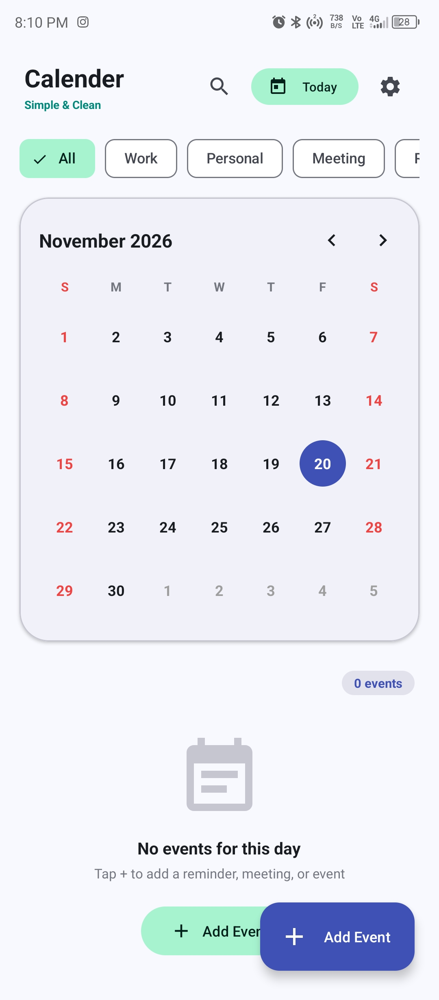
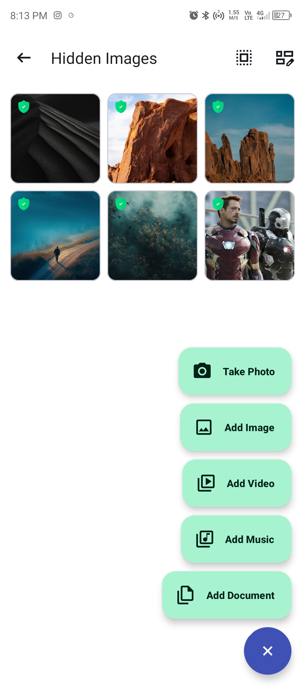
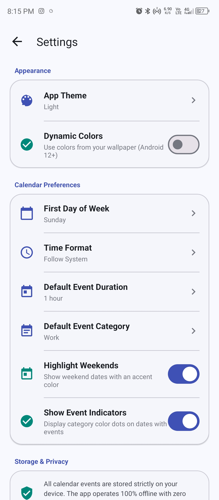
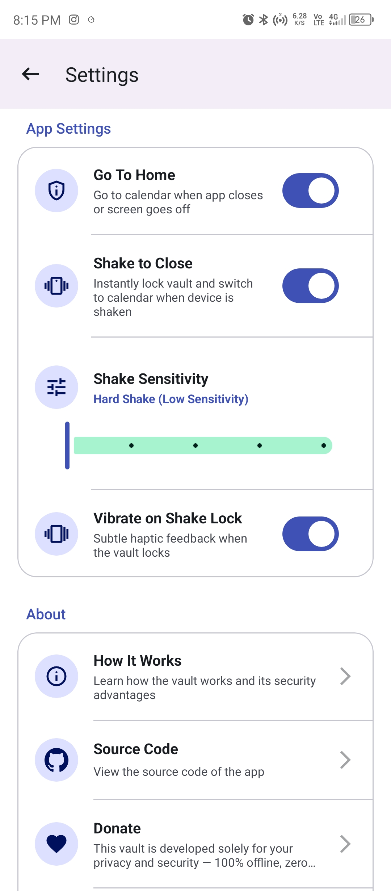
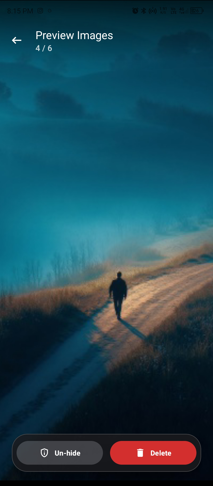
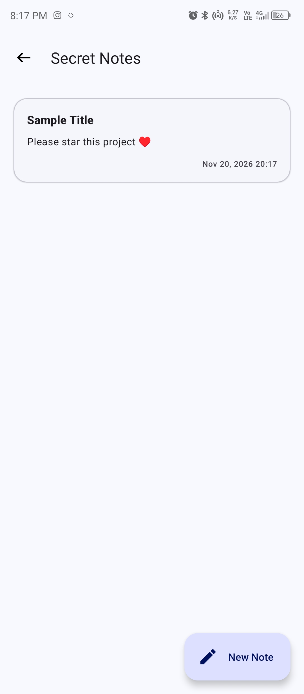
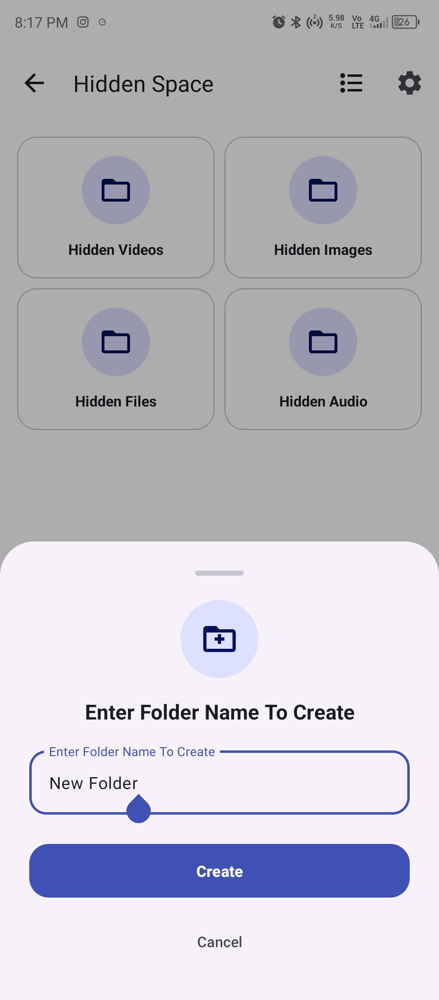
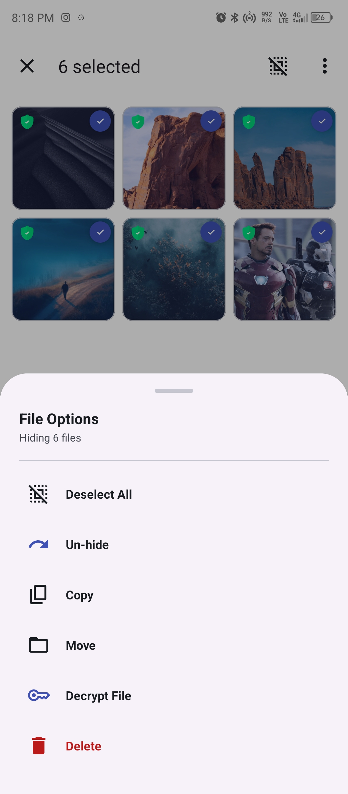
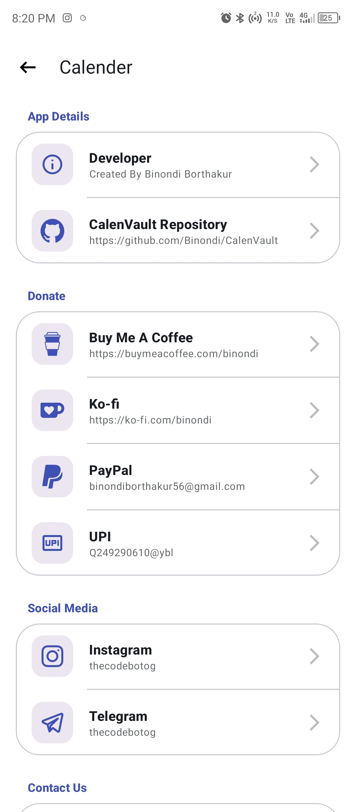

<div align="center">


# CalenVault

### Disguised Calendar & Secure Private Vault for Android

<p align="center">
  <a href="https://github.com/Binondi/CalenVault">
    
  </a>
  <a href="LICENSE">
    
  </a>
  <a href="https://github.com/Binondi/CalenVault">
    
  </a>
  <a href="https://github.com/Binondi/CalenVault">
    
  </a>
</p>

<p align="center">
  <b>A full-featured Material 3 calendar on the surface. An impenetrable, encrypted private vault underneath.</b>
</p>

</div>

---

## 📖 Overview

**CalenVault** is a privacy-first, open-source Android application designed to protect your sensitive personal files behind the disguise of an everyday, fully-functional **Calendar app**. 

Anyone picking up your phone will see an elegant calendar with events, schedule management, Material You theming, and reminders. But with your secret trigger, CalenVault unlocks a stealth private storage vault for your photos, videos, audio recordings, documents, and notes.

> **🔒 100% Offline & Private**  
> CalenVault requests **zero internet permissions** (`android.permission.INTERNET` is not included in the manifest). Your data, passwords, and private files never leave your device.

---

## ⭐ Why CalenVault?

- **Unmatched Camouflage**: Operates as a genuine daily calendar—no suspicious vault app names, fake calculation screens, or giveaway lock prompts.
- **3 Covert Access Triggers**: Multiple stealth entry methods so you can choose what feels most natural to you.
- **Zero Internet / Zero Tracking**: Complete privacy. No telemetry, no remote servers, no cloud leakage.
- **Military-Grade Encryption**: Optional AES-256-GCM encryption with your own master key and 100,000-iteration PBKDF2 key derivation.
- **Disaster-Proof Recovery**: Reinstalling the app or wiping app data will not destroy your files—our self-contained `CHFE` container preserves metadata and original formats for immediate restore.
- **Shake to Close**: Instantly dismiss the vault and return to the calendar when someone approaches.

---

## 🕵️ 3 Stealth Access Triggers

CalenVault gives you three distinct methods to open your private vault right from the calendar interface:

| Access Method | How It Works |
| :--- | :--- |
| 🔍 **Search Bar Trigger** | Type your secret passcode into the calendar event search bar and press search. |
| 🏷️ **Calendar Title Long-Press** | Long-press the Month & Year header text on the main calendar screen. |
| 🔄 **Multi-Tap "Today" Button** | Rapidly tap the "Today" action button 5 times in succession. |

> [!TIP]
> **Safety Guard**: You can enable or disable individual triggers in **Vault Settings**, but CalenVault ensures at least one trigger remains active at all times so you never get locked out.

---

## 🚀 Key Features

### 📅 Full-Featured Calendar
- **Interactive Month Grid**: Fast and fluid month navigation with indicators for scheduled events and holidays.
- **Comprehensive Event Management**: Create, edit, and organize events with custom titles, descriptions, categories, and times.
- **Event Categories**: Color-coded categorization (Work, Personal, Meeting, Birthday, Reminder, Health, and more).
- **Customizable Experience**:
  - Choice of first day of the week (Sunday, Monday, Saturday).
  - 12-hour (AM/PM) or 24-hour time formatting.
  - Configurable default event durations (15m, 30m, 45m, 60m, 90m, 120m).
- **Material 3 Design**: Edge-to-edge layout, Light/Dark mode, and dynamic color (Material You) adapting to your system wallpaper.

### 🛡️ Secure Vault Features
- **Multi-Type Vault Storage**: Organize and hide:
  - 📸 Photos & Images
  - 🎬 Videos
  - 🎵 Audio Recordings & Music
  - 📄 Documents (PDFs, docs, archives, etc.)
  - 📝 Secure Encrypted Notes
- **In-Vault Camera**: Capture confidential photos directly inside the vault without them ever appearing in your device gallery.
- **Folder Management**: Create custom nested folders, rename, move, copy, and organize hidden files.
- **Batch Operations**: Hide, unhide, export, and delete multiple files simultaneously.
- **Shake to Close Vault**: Shake your phone to instantly close the vault and lock it with optional haptic vibration feedback and sensitivity adjustment.
- **Screenshot Restriction (`FLAG_SECURE`)**: Prevent screenshots, screen recorders, and app switcher thumbnails from capturing your private vault content.
- **Security Question Recovery**: Recover your vault password using a secret security question and answer.
- **Isolated Storage**: Hidden files are secured inside the app's dedicated `.CalenVault` directory.

---

## 📱 Screenshots

<div align="center">
  
  
  
</div>
<br>
<div align="center">
  
  
  
</div>
<br>
<div align="center">
  
  
  
</div>

---

## 🔐 Cryptographic Architecture

CalenVault incorporates a state-of-the-art cryptographic architecture designed for authenticated encryption, zero-knowledge privacy, and disaster recovery:

```text
+---------------------------------------------------------------------------------+
| Magic ("CHFE") | Ver (0x01) | Salt (16B) | IV (12B) | Encrypted Payload + Tag   |
+---------------------------------------------------------------------------------+
                                                       |
                                                       v
                                          +---------------------------------------+
                                          | Metadata Length (4B) | JSON Metadata  |
                                          | - Original Name & Extension           |
                                          | - MIME Type & File Size               |
                                          | - Timestamp                           |
                                          +---------------------------------------+
                                          | Plaintext File Data Content           |
                                          +---------------------------------------+
```

1. **AES-256-GCM Authenticated Encryption**:
   - Galois/Counter Mode (GCM) provides both high-speed confidentiality and cryptographic data integrity verification.
   - Any corruption or unauthorized tampering is detected before decryption.

2. **PBKDF2 Key Derivation**:
   - Master encryption key derived from your passphrase using `PBKDF2WithHmacSHA256` with **100,000 iterations**.
   - Every file receives a unique 16-byte cryptographic salt and 12-byte initialization vector (nonce).

3. **Self-Contained `CHFE` Container**:
   - File metadata (original name, extension, MIME type, size) is embedded inside the encrypted payload itself.
   - Even if the SQLite/Room database is cleared or the app is uninstalled, entering your key immediately restores full file details, names, and previews.

4. **Atomic File Operations**:
   - File transformations write to temporary files first (`.tmp`), verify cryptographic integrity, and replace atomically to prevent data loss.

---

## 🛠️ Tech Stack & Architecture

- **Language**: 100% Kotlin
- **UI Framework**: Android Jetpack, Material Design 3, ViewBinding
- **Architecture**: Clean Architecture / MVVM principles with Kotlin Coroutines & Flow
- **Persistence**: Room Database (Vault file registry & notes) & SQLite Helper (Calendar events)
- **Security & Crypto**: Java Cryptography Extension (JCE), AES-256-GCM, PBKDF2, Android KeyStore
- **Permissions**: Scoped Storage & `MANAGE_EXTERNAL_STORAGE` (for cross-directory vault file hiding/restoration)

---

## 📥 Building from Source

### Prerequisites
- Android Studio Ladybug / Meerkat or newer
- JDK 17+
- Android SDK 35 (`compileSdk = 35`, `minSdk = 26`, `targetSdk = 35`)

### Steps
1. **Clone the repository**:
   ```bash
   git clone https://github.com/Binondi/CalenVault.git
   cd CalenVault
   ```

2. **Open in Android Studio** and sync Gradle dependencies.

3. **Build the Debug APK**:
   ```bash
   ./gradlew assembleDebug
   ```
   Or run directly on an emulator or connected device via Android Studio.

---

## 🤝 Contributing

Contributions, feature suggestions, and bug reports are welcome!

1. Fork the project.
2. Create your feature branch (`git checkout -b feature/AmazingFeature`).
3. Commit your changes (`git commit -m 'Add some AmazingFeature'`).
4. Push to the branch (`git push origin feature/AmazingFeature`).
5. Open a Pull Request.

---

## 💖 Support the Project

If you find **CalenVault** useful and appreciate open-source, privacy-first software, please consider supporting development:

[](https://github.com/sponsors/Binondi)
[](https://buymeacoffee.com/binondi)
[](https://ko-fi.com/binondi)
[](https://paypal.me/binondi)

- **UPI (India)**: `Q249290610@ybl`

---

## 📜 License

This project is licensed under the **GNU General Public License v3.0 (GPL-3.0)**.

- **Free & Open Source**: You are free to run, study, modify, and redistribute the software under the terms of GPL-3.0.
- **Copyleft**: Derivative works or distributions must also be released under the GNU GPL v3.0 with complete source code.
- **Attribution**: Original copyright notices and author credits must be retained.
- **Trademark Notice**: The name *"CalenVault"*, app icons, and branding assets are proprietary trademarks of Binondi Borthakur and are not covered under the GPLv3 source code grant.

See the full [LICENSE](LICENSE) file for details.

---

## 📬 Contact & Socials

- **Developer**: Binondi Borthakur
- **Email**: [borthakurbinondi@gmail.com](mailto:borthakurbinondi@gmail.com)
- **GitHub**: [@Binondi](https://github.com/binondi)
- **Telegram**: [@thecodebotog](https://t.me/thecodebotog)
- **Instagram**: [@thecodebotog](https://www.instagram.com/thecodebotog)

<div align="center">
  <sub>Made with ❤️ by <a href="https://github.com/binondi">Binondi</a></sub>
</div>
